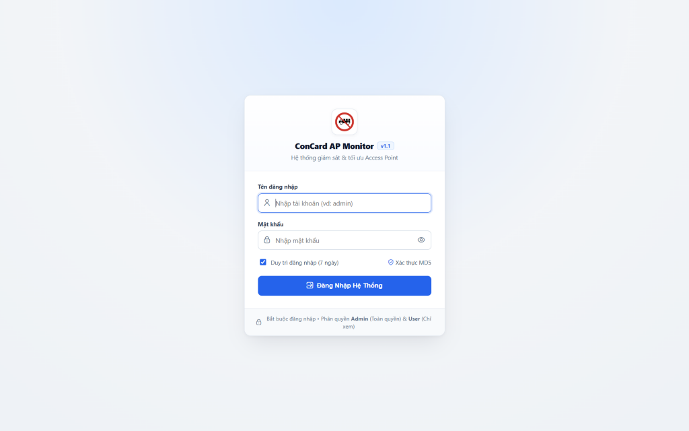
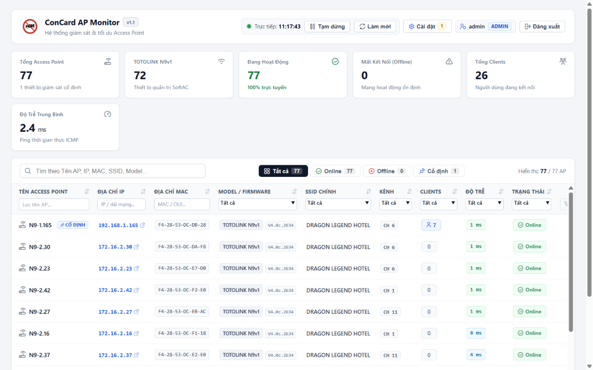
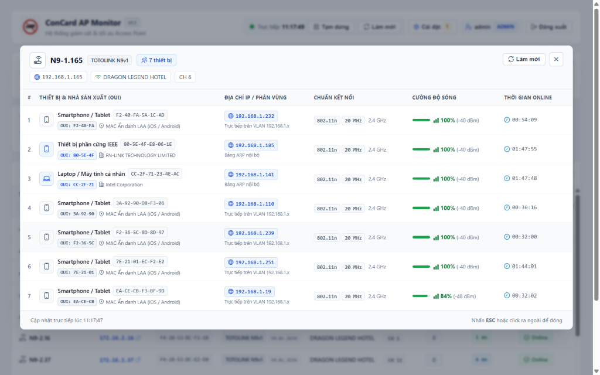
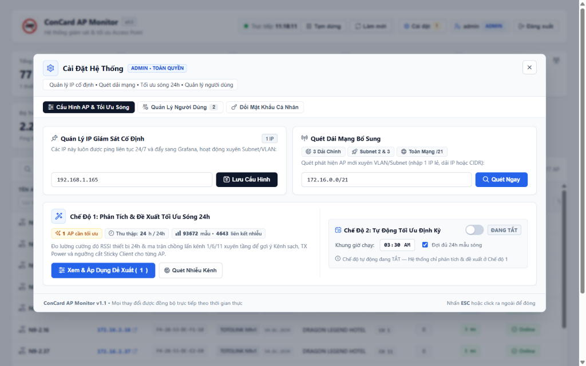
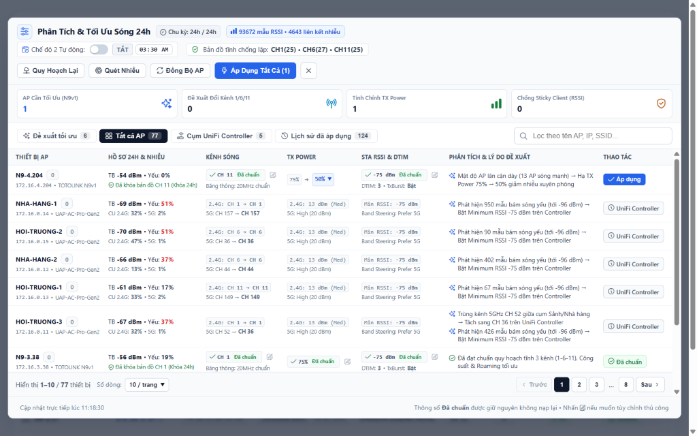
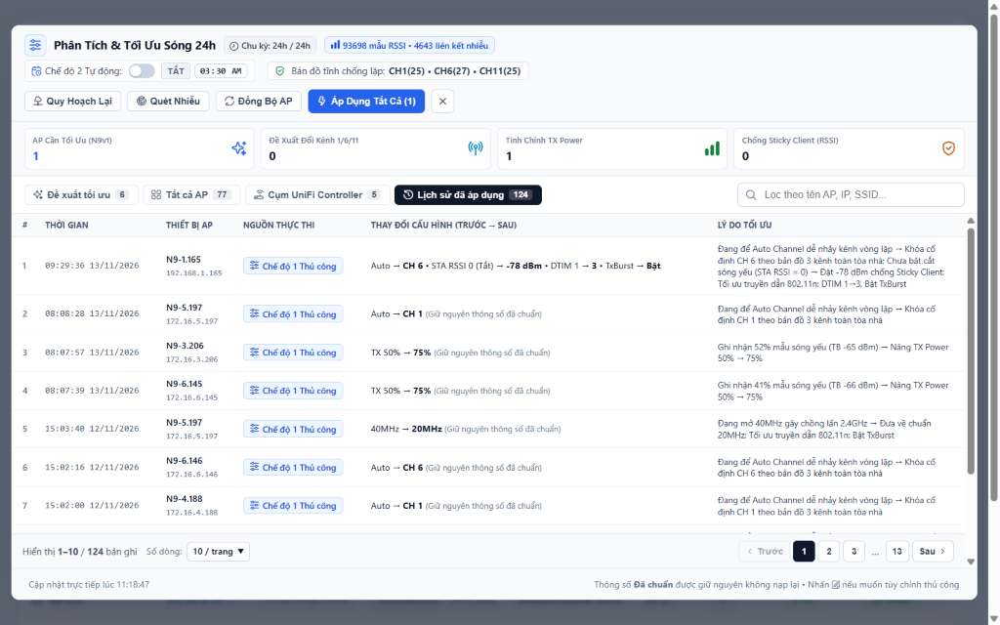
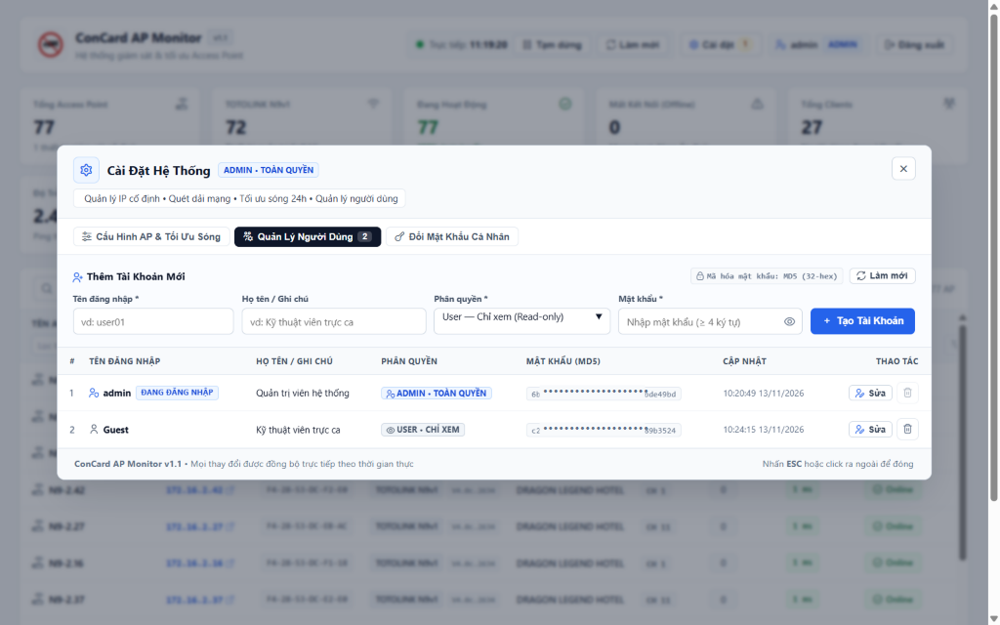

<div align="center">
  
  <h1>Concard_N9v1 — ConCard AP Monitor v1.1</h1>
  <p><b>Hệ thống quản lý, giám sát thời gian thực &amp; tối ưu sóng Wi-Fi 24h chuyên dụng cho Access Point TOTOLINK N9 / N9v1</b></p>
  <p>
    
    
    
    
    
  </p>
</div>

---

## 1. Giới Thiệu Tổng Quan

**Concard_N9v1** (*ConCard AP Monitor v1.1*) là giải pháp phần mềm độc lập (Standalone) được thiết kế chuyên biệt để quản trị tập trung, giám sát độ trễ và tự động tối ưu chất lượng sóng vô tuyến cho hệ thống **Access Point TOTOLINK N9 / N9v1** quy mô lớn tại khách sạn, tòa nhà, khu nghỉ dưỡng, văn phòng và trường học (đồng thời hỗ trợ giám sát mở rộng các cụm AP UniFi trong cùng hạ tầng mạng).

### Điểm khác biệt cốt lõi:
- **Vượt qua giới hạn VLAN / Subnet của SoftAC truyền thống:** Kết hợp đa cơ chế dò tìm và đồng bộ (`ICMP Ping`, `ARP Table`, `SoftAC UDP Broadcast`, `TOTOLINK HTTP CGI` & `SSH`) giúp giám sát xuyên suốt các AP nằm khác dải mạng hoặc bị cô lập Broadcast.
- **100% Thuần Node.js — Không phụ thuộc thư viện ngoài (`Zero External Dependencies`):** Khởi chạy tức thì bằng `node.exe` Portable đi kèm mà không cần `npm install` hay cài đặt cơ sở dữ liệu phức tạp.
- **Động cơ Tối ưu sóng 24h (RF Optimizer 24h):** Thu thập mẫu cường độ tín hiệu `RSSI` thực tế của thiết bị người dùng trong 24 giờ kết hợp ma trận chồng lấn kênh để quy hoạch tĩnh 3 kênh sạch `1 - 6 - 11`, tinh chỉnh `TX Power` và ngưỡng cắt `Sticky Client (STA RSSI)`.
- **Tích hợp sẵn Native Prometheus API Server:** Cho phép **Grafana** kết nối trực tiếp vào cổng `9100` để vẽ biểu đồ băng thông & trạng thái AP mà không cần cài đặt máy chủ Prometheus trung gian.

---

## 2. Hình Ảnh Giao Diện & Chức Năng Thực Tế

### 2.1. Màn hình Đăng nhập bảo mật
Bắt buộc xác thực người dùng trước khi truy cập hệ thống (mật khẩu băm `MD5`, phiên đăng nhập ký số `HMAC-SHA256` chống giả mạo Cookie):



### 2.2. Dashboard Giám sát trung tâm (Thời gian thực qua SSE)
Giao diện tinh gọn hiển thị 6 chỉ số KPI tổng quan, bộ lọc đa tiêu chí ngay trên từng cột dữ liệu và luồng cập nhật trực tiếp không cần tải lại trang:



### 2.3. Giám sát chi tiết Thiết bị kết nối (Wi-Fi Clients) & Nhận diện OUI
Nhấn trực tiếp vào huy hiệu số lượng Client trên từng AP để kiểm tra danh sách thiết bị đang kết nối, hãng sản xuất phần cứng (tra cứu offline **40.467 mã IEEE OUI**), địa chỉ IP/VLAN, chuẩn `802.11n`, cường độ sóng `RSSI` và thời gian kết nối:



### 2.4. Trung tâm Cài đặt hệ thống (Quản lý IP cố định, Quét mạng & Chế độ tối ưu)
Hợp nhất toàn bộ công cụ cấu hình vào hộp thoại **Cài Đặt Hệ Thống** gọn gàng:



### 2.5. Bảng Phân tích & Tối ưu sóng 24h (RF Optimizer)
Phân tích hồ sơ sóng 24h của từng AP TOTOLINK N9v1, tự động giữ nguyên các thông số **Đã chuẩn** (không nạp lại thừa) và cho phép áp dụng trực tiếp từng AP hoặc đồng loạt kèm thanh tiến trình thời gian thực:



### 2.6. Nhật ký Lịch sử tối ưu sóng (Có phân trang & tìm kiếm)
Lưu vết bền vững toàn bộ lịch sử thay đổi cấu hình trước và sau khi tối ưu (thủ công hoặc tự động định kỳ) trong `rf_telemetry_24h.json`:



### 2.7. Quản lý Người dùng & Phân quyền (`Admin` / `User`)
Phân tách rõ quyền quản trị toàn diện (`Admin`) và quyền giám sát chỉ xem (`User - Read-only`) dành cho nhân viên trực vận hành:



---

## 3. Mô Tả Chi Tiết Các Nhóm Chức Năng

| Nhóm chức năng | Mô tả chi tiết |
| :--- | :--- |
| **Giám sát AP đa tầng (Multi-VLAN)** | Ping ICMP định kỳ (mặc định `4s`), đọc bảng `ARP`, lắng nghe gói tin `SoftAC` và truy vấn trực tiếp `HTTP CGI` của TOTOLINK N9v1 để cập nhật Tên AP, IP, MAC, Firmware, SSID, Kênh phát, Số lượng Client và Độ trễ (`ms`). |
| **Quản lý IP Giám sát cố định** | Gán danh sách IP AP cố định để theo dõi 24/7 xuyên Router/VLAN/Firewall ngay cả khi mạng chặn gói tin quảng bá. |
| **Quét dải mạng bổ sung** | Hỗ trợ quét nhanh theo IP đơn lẻ (`192.168.1.165`), danh sách dải mạng hoặc ký hiệu CIDR (`192.168.1.0/24`, `172.16.0.0/21`) kèm các nút chọn nhanh (Preset). |
| **Lọc & Sắp xếp nâng cao** | Tìm kiếm toàn cục kết hợp bộ lọc riêng trên từng cột (Tên AP, IP, MAC, Model/Firmware, SSID, Kênh, Clients, Độ trễ, Trạng thái), sắp xếp tăng/giảm dần và xóa nhanh các AP Offline cũ. |
| **Tối ưu sóng 24h (Chế độ 1 & 2)** | • **Quy hoạch 3 kênh tĩnh (`1 - 6 - 11`):** Chống nhiễu đồng kênh (Co-channel) và khóa bản đồ kênh 24h tránh hiện tượng Auto Channel nhảy kênh vòng lặp.<br>• **Độ rộng kênh chuẩn `20MHz`:** Giảm nhiễu giao thoa băng tần `2.4GHz`.<br>• **Tinh chỉnh `TX Power` (`25%–100%`):** Giảm nhiễu xuyên phòng khi mật độ AP dày hoặc tăng công suất tại vùng sóng yếu.<br>• **Chống Sticky Client (`STA RSSI`):** Tự động ngắt kết nối các thiết bị bám sóng quá yếu (mặc định `-75 dBm` / `-76 dBm`) để chuyển vùng (Roaming) sang AP gần hơn, đồng thời tối ưu `DTIM = 3` và bật `TxBurst`.<br>• **Hẹn giờ tự động (Chế độ 2):** Tự động chạy tối ưu vào khung giờ vắng khách (ví dụ `03:30 AM`). |
| **Phân quyền Bảo mật (`RBAC`)** | • **Admin:** Thêm/quét/xóa AP, thực thi tối ưu sóng, cấu hình hẹn giờ, thêm/sửa/xóa tài khoản người dùng.<br>• **User:** Chỉ có quyền xem Dashboard, xem danh sách Client, xem phân tích sóng & tự đổi mật khẩu cá nhân (mọi API ghi đều được chặn bảo vệ ở tầng Backend HTTP `403`). |
| **Tích hợp Grafana & Prometheus** | Xuất chuẩn Prometheus text tại `/metrics` và giả lập trực tiếp Prometheus HTTP Query API (`/api/v1/query`, `/api/v1/query_range`, `/api/v1/labels`, `/api/v1/series`). |

---

## 4. Hướng Dẫn Cài Đặt

### Yêu cầu hệ thống
- **Hệ điều hành:** Windows 10 / 11 hoặc Windows Server 2016 / 2019 / 2022 (có thể chạy trên Linux với Node.js).
- **Mạng:** Máy chạy phần mềm có kết nối mạng LAN/VLAN nhìn thấy (route/ping được) tới các thiết bị Access Point TOTOLINK N9 / N9v1.
- **Cổng mặc định:** `TCP 9100` (có thể tùy chỉnh trong `config.json`).

### Cách 1: Sử dụng bản Đóng gói Portable trên Windows (Khuyên dùng — Chạy ngay không cần cài đặt)
1. Vào mục **[Releases](https://github.com/fbaduongth/Concard_N9v1/releases)** của kho lưu trữ và tải gói `Concard_N9v1_v1.1_Portable.zip`.
2. Giải nén vào thư mục bất kỳ trên máy chủ (ví dụ `C:\Concard_N9v1`).
3. Mở file `config.json` để cập nhật mật khẩu đăng nhập thiết bị AP TOTOLINK thực tế của bạn *(xem Mục 5 bên dưới)*.
4. Nhấp đúp chạy file **`start_collector.bat`**.
5. Mở trình duyệt truy cập: **http://localhost:9100/**.

### Cách 2: Chạy từ Mã nguồn với Node.js cài sẵn
Nếu máy tính đã cài sẵn [Node.js](https://nodejs.org/) (phiên bản bất kỳ từ `v12+` / `v18+` / `v20+` / `v22+`):
```bash
git clone https://github.com/fbaduongth/Concard_N9v1.git
cd Concard_N9v1
# Chỉnh sửa mật khẩu AP trong file config.json trước khi chạy
node standalone_ap_collector.js
```

---

## 5. Cấu Hình Mật Khẩu AP & Thông Số Mạng (`config.json`)

> **Quan trọng về bảo mật:** Trước khi vận hành thực tế, hãy mở file `config.json` bằng Notepad / VS Code và thay các mật khẩu mẫu trong mục `apCredentials` bằng tài khoản & mật khẩu quản trị thực tế của dàn thiết bị **TOTOLINK N9 / N9v1** trong mạng của bạn.

```json
"network": {
  "defaultScanTarget": "192.168.1.0/24",
  "defaultStaticIps": [
    "192.168.1.165"
  ]
},
"apCredentials": {
  "sshUsername": "admin",
  "sshPasswords": [
    "MAT_KHAU_SSH_AP_CUA_BAN"
  ],
  "totolinkWebUsername": "admin",
  "totolinkWebPasswords": [
    "MAT_KHAU_WEB_AP_CUA_BAN"
  ],
  "perApPasswords": {
    "192.168.1.200": { "username": "admin", "password": "MAT_KHAU_RIENG_NEU_CO" }
  },
  "defaultSsidFallback": "ConCard_WiFi"
}
```

- Hệ thống hỗ trợ **danh sách nhiều mật khẩu dự phòng** (`totolinkWebPasswords` / `sshPasswords`) trong trường hợp các lô AP trong tòa nhà dùng nhiều mật khẩu khác nhau, hoặc khai báo mật khẩu riêng cho từng IP/MAC tại `perApPasswords`.
- Mọi chỉnh sửa và lưu trên file `config.json` sẽ được phần mềm **tự động nhận diện và nạp nóng (Hot-reload)** ngay lập tức mà không cần tắt bật lại dịch vụ.

---

## 6. Hướng Dẫn Sử Dụng Phần Mềm

### Bước 1: Đăng nhập hệ thống lần đầu
- Truy cập **http://localhost:9100/** (hoặc `http://<IP-Máy-Chủ>:9100/`).
- Khi khởi chạy lần đầu tiên (chưa có file `users.json`), hệ thống tự động khởi tạo tài khoản Quản trị viên mặc định:
  - **Tên đăng nhập:** `admin`
  - **Mật khẩu mặc định:** `Concard@2026`
- Sau khi đăng nhập, nhấn nút **Cài đặt** trên thanh công cụ → chuyển sang tab **Đổi Mật Khẩu Cá Nhân** để đổi sang mật khẩu riêng của bạn.

### Bước 2: Thêm Access Point vào danh sách giám sát
Nhấn nút **Cài đặt** ở góc phải trên cùng → tại tab **Cấu Hình AP & Tối Ưu Sóng**:
1. **Quản Lý IP Giám Sát Cố Định:** Nhập danh sách các địa chỉ IP AP cách nhau bởi dấu phẩy (ví dụ: `172.16.1.20, 192.168.1.165`) rồi nhấn **Lưu Cấu Hình** để hệ thống giám sát cố định 24/7.
2. **Quét Dải Mạng Bổ Sung:** Nhập dải mạng cần dò tìm (ví dụ: `192.168.1.0/24` hoặc `172.16.0.0/21`) rồi nhấn **Quét Ngay** để tự động phát hiện toàn bộ AP TOTOLINK trên mạng.

### Bước 3: Theo dõi, Lọc thiết bị & Kiểm tra người dùng Wi-Fi
- Trên bảng chính, sử dụng ô tìm kiếm nhanh hoặc các ô lọc dưới tiêu đề từng cột để lọc theo dải IP, kênh phát (`CH 1`, `CH 6`, `CH 11`), SSID hoặc trạng thái `Online` / `Offline`.
- Nhấn vào con số ở cột **CLIENTS** của bất kỳ AP nào đang có người kết nối để mở bảng thông tin chi tiết từng thiết bị đầu cuối.
- Có thể xóa từng AP không còn sử dụng bằng biểu tượng thùng rác ở cột **Thao Tác**, hoặc nhấn nút **Xóa Offline** để dọn nhanh các AP cũ đã tháo dỡ.

### Bước 4: Phân tích & Tối ưu sóng Wi-Fi 24h
- Mở **Cài đặt** → tại khung **Chế Độ 1: Phân Tích & Đề Xuất Tối Ưu Sóng 24h**, nhấn **Xem & Áp Dụng Đề Xuất**:
  - Kiểm tra các đề xuất đổi kênh `1/6/11`, `TX Power` và ngưỡng `STA RSSI` cho từng AP TOTOLINK N9v1.
  - Có thể tùy chỉnh thông số ngay trên dòng rồi nhấn **Áp dụng** cho từng AP, hoặc nhấn **Áp Dụng Tất Cả** để hệ thống tự động nạp tuần tự và cập nhật trạng thái trực tiếp.
  - Các thông số đã đúng chuẩn trên phần cứng AP sẽ được gắn nhãn **Đã chuẩn** và giữ nguyên, tránh khởi động lại radio không cần thiết.
- Nếu muốn hệ thống tự động tối ưu định kỳ vào ban đêm, gạt công tắc bật **Chế Độ 2: Tự Động Tối Ưu Định Kỳ** và chọn khung giờ chạy (mặc định `03:30 AM`).

### Bước 5: Tạo tài khoản phân quyền cho nhân viên trực ca
- Mở **Cài đặt** → chuyển sang tab **Quản Lý Người Dùng**.
- Nhập Tên đăng nhập, Họ tên/Ghi chú, chọn phân quyền **`User — Chỉ xem (Read-only)`** hoặc **`Admin — Toàn quyền quản trị`**, nhập mật khẩu và nhấn **Tạo Tài Khoản**.

### Bước 6: Kết nối biểu đồ lên Grafana (Tùy chọn)
1. Trong Grafana, vào **Connections → Data sources → Add data source → Prometheus**.
2. Điền URL trỏ trực tiếp tới máy chủ ConCard AP Monitor: `http://<IP-Máy-Chủ>:9100` rồi nhấn **Save & test**.
3. Vào **Dashboards → New → Import** và tải lên file `grafana-dashboard-ap-network.json` đi kèm trong dự án để hiển thị trọn bộ biểu đồ lưu lượng băng thông, độ trễ và phân bổ kênh sóng.

---

## 7. Cấu Trúc Thư Mục Dự Án

```text
Concard_N9v1/
├── assets/
│   ├── oui_vendors.json                 # Cơ sở dữ liệu 40.467 mã OUI hãng sản xuất phần cứng
│   └── uicons/                          # Bộ icon giao diện hoạt động Offline 100%
├── docs/
│   └── screenshots/                     # Ảnh chụp màn hình giao diện & tính năng phần mềm
├── runtime/
│   └── RUNTIME_GUIDE.md                 # Hướng dẫn đặt node.exe Portable (có sẵn trong bản ZIP)
├── standalone_ap_collector.js           # Nhân phần mềm: Collector, Web UI, RF 24h, Auth & Prometheus API
├── config.json                          # File cấu hình hệ thống & mật khẩu AP (tự động Hot-reload)
├── config.example.json                  # File cấu hình mẫu tham khảo
├── start_collector.bat                  # Script khởi chạy nhanh 1-click trên Windows
├── grafana-dashboard-ap-network.json    # Mẫu Dashboard Grafana dựng sẵn cho hệ thống AP
├── docker-compose.yml                   # Cấu hình Docker tùy chọn cho Grafana & Prometheus
├── prometheus.yml                       # Cấu hình scrape mẫu cho Prometheus
├── calculate_metrics.js                 # Tiện ích thống kê nhanh lưu lượng băng thông từ CLI
├── update_grafana_dashboard.js          # Tiện ích đồng bộ cấu hình Dashboard qua Grafana API
├── logo.svg                             # Biểu trưng ConCard AP Monitor
├── package.json                         # Thông tin gói dự án Node.js
└── README.md                            # Tài liệu mô tả & hướng dẫn sử dụng
```

---

## 8. Bản Quyền & Tác Giả

- Phát triển & đóng gói cho hệ thống quản trị Access Point **ConCard AP Monitor v1.1** (`Concard_N9v1`).
- GitHub: [https://github.com/fbaduongth/Concard_N9v1](https://github.com/fbaduongth/Concard_N9v1)
- Giấy phép: [MIT License](./LICENSE).
